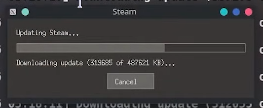

# Steam GUI Update Dialog Missing on EndeavourOS (Arch-based)

## The Problem

When launching Steam for the first time on **EndeavourOS** (or a minimal Arch install), the graphical "Updating Steam..." progress dialog does **not** appear. Instead, Steam falls back to a text-only console progress display in the terminal.

On a standard Arch Linux install, you'd normally see this GUI window:



But on EndeavourOS, you only get terminal output like:

```
[  3%] Downloading update (15,598 of 496,367 KB)...
[  3%] Downloading update (16,320 of 496,367 KB)...
```

This can cause confusion — users may think Steam is crashing or broken because no window appears.

## Root Cause

Steam's bootstrapper (`~/.local/share/Steam/ubuntu12_32/steam`) is a **32-bit binary** that tries to create a graphical update window using **SDL3** and **X11/XRandr**.

By running `strings` on the binary, we can see the three update UI modes it supports:

```
Using update UI: glx       # OpenGL-based window
Using update UI: xwin      # X11 window (what we want)
Using update UI: console   # Text-only fallback
```

The binary dynamically loads (`dlopen`) these 32-bit libraries at runtime:

| Library | Purpose | Package |
|---|---|---|
| `libSDL3.so.0` | Window creation, input, rendering | `lib32-sdl3` |
| `libX11.so.6` | X11 display connection | `lib32-libx11` |
| `libXrandr.so.2` | Display/monitor detection | `lib32-libxrandr` |

On EndeavourOS, `lib32-sdl3` and `lib32-libxrandr` are **not installed by default** and are **not** listed as dependencies of the `steam` package. Without them, the binary silently fails to initialize the graphical UI and falls back to `console` mode.

### How we diagnosed it

1. **Checked the terminal log** — found the line:
   ```
   [2026-10-02 12:42:50] Using update UI: console
   ```
   This confirmed Steam was intentionally falling back to text mode.

2. **Checked the Steam log** at `~/.local/share/Steam/logs/updateui_child.txt` — same `console` output, no error details.

3. **Ran `strings` on the Steam binary** to discover what libraries it loads:
   ```bash
   strings ~/.local/share/Steam/ubuntu12_32/steam | grep -i "SDL\|libX\|update.ui"
   ```
   Output revealed it needs `libSDL3.so.0`, `libX11.so.6`, and `libXrandr.so.2`.

4. **Checked which 32-bit libraries were present**:
   ```bash
   find /usr/lib32 -name "libSDL3*"    # MISSING
   find /usr/lib32 -name "libXrandr*"  # MISSING
   find /usr/lib32 -name "libX11*"     # Present ✓
   ```

## The Fix

Install the missing 32-bit libraries:

```bash
sudo pacman -S lib32-sdl3 lib32-libxrandr
```

This also pulls in these transitive dependencies:
- `lib32-libusb`
- `lib32-libxcursor`
- `lib32-libxrender`

Then reset Steam and relaunch:

```bash
rm -rf ~/.local/share/Steam
steam
```

### After the fix

The log now shows:
```
[2026-10-02 12:55:28] Using update UI: xwin
```

And the graphical progress dialog appears as expected.

## Affected Systems

- **EndeavourOS** (confirmed)
- Likely any **minimal Arch-based install** where Steam is installed via `pacman -S steam` without manually adding the 32-bit GUI dependencies
- The `steam` package (v1.0.0.87-3) does **not** declare `lib32-sdl3` or `lib32-libxrandr` as required dependencies

## Quick Reference

```bash
# Diagnose: check which update UI mode Steam is using
grep "Using update UI" ~/.local/share/Steam/logs/updateui_child.txt

# Diagnose: check what the binary needs
strings ~/.local/share/Steam/ubuntu12_32/steam | grep "libSDL\|libX"

# Diagnose: check if 32-bit libs are present
find /usr/lib32 -name "libSDL3*" -o -name "libXrandr*"

# Fix
sudo pacman -S lib32-sdl3 lib32-libxrandr
```

## Environment

| Component | Value |
|---|---|
| OS | EndeavourOS rolling (Arch-based) |
| Desktop | KDE Plasma (Wayland) |
| Steam package | `steam 1.0.0.87-3` |
| Missing packages | `lib32-sdl3`, `lib32-libxrandr` |

## License

Public domain — use this however you want.
